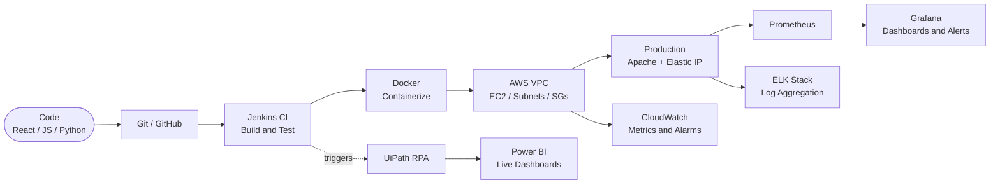

<div align="center">


<br/>


<br/><br/>

<a href="https://www.linkedin.com/in/YOUR-LINKEDIN-SLUG"></a>
<a href="https://github.com/psgaikwad2003/"></a>
<a href="mailto:psgaikwad2003@gmail.com"></a>
<a href="https://wa.me/919359850496"></a>

<br/><br/>


</div>

<br/>


## 👋 About Me

I am a **Computer Engineering graduate** who enjoys the full journey of software: writing the app, containerizing it, deploying it on AWS and monitoring it. My motto: **ship reliable systems, automate everything, never touch it twice.**

```yaml
name         : Prajwal Gaikwad
role         : Full-Stack Developer · Cloud & DevOps Engineer
location     : Pune, Maharashtra, IN
education    : B.E. Computer Engineering | CGPA 8.83/10
               Pravara Rural Engineering College, Loni
building     : CI/CD pipelines + containerized deployments on AWS
learning     : Kubernetes · Terraform · GitHub Actions
looking_for  : DevOps / Cloud / Full-Stack roles
ask_me_about : AWS VPC · Docker · Jenkins · React · RPA with UiPath
```

<br/>


## 🧰 Tech Stack

<div align="center">

**☁️ Cloud & DevOps**
<br/>


**📡 Observability**
<br/>
&nbsp;

**💻 Languages & Frameworks**
<br/>


**🗄️ Database, Tools & Automation**
<br/>
&nbsp;&nbsp;

**🎯 Currently Learning**
<br/>


</div>

<br/>

## 🚀 How My Code Ships



<br/>


## 🏗️ Featured Projects

<table width="100%">
<tr>
<td width="50%" valign="top">

### ☁️ AWS VPC Web Server Deployment
`EC2` `VPC` `IAM` `Security Groups` `NAT Gateway`

- Custom VPC with public/private subnets, route tables and NAT
- Hardened EC2 (Apache) with Security Groups, NACLs and Elastic IP
- AWS Well-Architected Framework practices applied

</td>
<td width="50%" valign="top">

### 🧾 Invoice Extraction Automation
`UiPath` `Power BI` `RPA`

- End-to-end RPA pipeline: vendor, amount, date, tax
- Live Power BI dashboards for real-time financial data
- Zero manual data entry

</td>
</tr>
<tr>
<td width="50%" valign="top">

### 📦 Stock Management System
`HTML` `CSS` `JS` `MySQL` `RBAC`

- Automated low-stock alerts
- Role-based access control
- Query optimization for large datasets

</td>
<td width="50%" valign="top">

### 🛒 E-Commerce Platform
`HTML` `CSS` `JavaScript`

- Dynamic product filtering
- Real-time cart updates
- Fully responsive UI

</td>
</tr>
</table>

<!--
  PINNED REPO CARDS: uncomment after replacing REPO-1 / REPO-2 with real repo names.
  <div align="center">
  <a href="https://github.com/psgaikwad2003/REPO-1"></a>
  <a href="https://github.com/psgaikwad2003/REPO-2"></a>
  </div>
-->

<br/>


## 💼 Experience

```bash
[2024-12-01 → 2025-02-28] Web Development Intern @ Exaltasoft Solutions, Pune
  ├─ Built responsive React.js components from design specs
  ├─ Integrated REST APIs for dynamic front-end features
  └─ Cross-browser testing → resolved rendering defects pre-deploy

[2024-02-01 → 2024-03-31] Python Programming Intern
  └─ Automated backend data-handling workflows via Python scripts
```

<br/>

## 📊 GitHub Stats

<div align="center">


</div>

<!--
  SNAKE + 3D GRAPH: uncomment AFTER you have added .github/workflows/profile.yml
  and run it once from the Actions tab (otherwise these images appear broken).

  <div align="center">
  
  
  </div>
-->

<br/>

## 🎓 Certifications

<div align="center">


</div>

<br/>


<div align="center">

### 📡 Connect with me

📧 **psgaikwad2003@gmail.com** &nbsp;│&nbsp; 📱 **+91 9359850496** &nbsp;│&nbsp; 📍 **Pune, Maharashtra, India**


</div>
