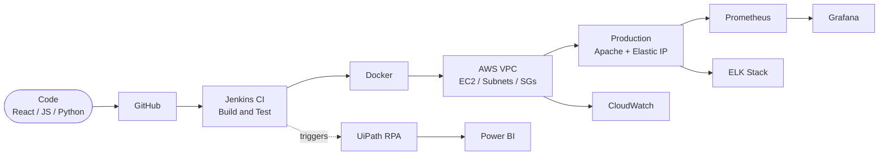

 

<!-- ─── NAVIGATION (click to jump) ─── -->

  

  

 

<h2 id="about">👋 About</h2>

I build, containerize, deploy and monitor software. I'm a **Computer Engineering graduate** (CGPA 8.83) focused on **AWS, Docker, CI/CD and React**, and I like automating anything I'd otherwise do twice.

<table>
<tr>
<td>🔭 <b>Building</b></td>
<td>CI/CD pipelines and containerized deployments on AWS</td>
</tr>
<tr>
<td>🌱 <b>Learning</b></td>
<td>Kubernetes · Terraform · GitHub Actions</td>
</tr>
<tr>
<td>🎓 <b>Education</b></td>
<td>B.E. Computer Engineering, Pravara Rural Engineering College, Loni</td>
</tr>
<tr>
<td>📍 <b>Based in</b></td>
<td>Pune, Maharashtra, India</td>
</tr>
<tr>
<td>💬 <b>Ask me about</b></td>
<td>AWS VPC · Docker · Jenkins · React · RPA with UiPath</td>
</tr>
<tr>
<td>🎯 <b>Looking for</b></td>
<td>DevOps, Cloud or Full-Stack roles</td>
</tr>
</table>

 

<h2 id="stack">🧰 Stack (click any icon)</h2>

<table>
<tr><td align="center"><b>☁️ Cloud & DevOps</b></td><td>

</td></tr>
<tr><td align="center"><b>📡 Observability</b></td><td>

</td></tr>
<tr><td align="center"><b>💻 Code</b></td><td>

</td></tr>
<tr><td align="center"><b>🗄️ Data & Tools</b></td><td>

</td></tr>
<tr><td align="center"><b>🎯 Learning</b></td><td>

</td></tr>
</table>

 

<h2 id="projects">🏗️ Projects (click to expand)</h2>

<b>☁️ AWS VPC Web Server Deployment</b> &nbsp;·&nbsp; <code>EC2</code> <code>VPC</code> <code>IAM</code> <code>NAT</code>

 

- Designed a **custom VPC** with public and private subnets, route tables and a NAT gateway
- Hardened an **Apache EC2** server using Security Groups, NACLs and an Elastic IP
- Applied **AWS Well-Architected** practices for security and reliability

<!-- 🔗 Add: [📂 Repo](https://github.com/psgaikwad2003/REPO) · [📖 Write-up](URL) -->

<b>🧾 Invoice Extraction Automation</b> &nbsp;·&nbsp; <code>UiPath</code> <code>Power BI</code> <code>RPA</code>

 

- End-to-end RPA pipeline that extracts **vendor, amount, date and tax**
- **Live Power BI dashboards** for real-time financial data
- Zero manual data entry

<!-- 🔗 Add: [📂 Repo](https://github.com/psgaikwad2003/REPO) -->

<b>📦 Stock Management System</b> &nbsp;·&nbsp; <code>HTML</code> <code>CSS</code> <code>JS</code> <code>MySQL</code>

 

- Automated **low-stock alerts**
- **Role-based access control** (RBAC)
- Query optimization for large datasets

<!-- 🔗 Add: [📂 Repo](https://github.com/psgaikwad2003/REPO) -->

<b>🛒 E-Commerce Platform</b> &nbsp;·&nbsp; <code>HTML</code> <code>CSS</code> <code>JavaScript</code>

 

- Dynamic **product filtering**
- **Real-time cart** updates
- Fully responsive UI

<!-- 🔗 Add: [📂 Repo](https://github.com/psgaikwad2003/REPO) · [🌐 Live demo](URL) -->

 

<b>🚀 See how my code ships (deployment pipeline)</b>

 

 

<h2 id="experience">💼 Experience</h2>

<b>Web Development Intern</b> · Exaltasoft Solutions, Pune &nbsp;Dec 2024 – Feb 2025

 

- Built responsive **React.js** components from design specs
- Integrated **REST APIs** for dynamic front-end features
- Ran cross-browser testing and fixed rendering defects before deploy

<b>Python Programming Intern</b> &nbsp;Feb 2024 – Mar 2024

 

- Automated backend data-handling workflows with **Python scripts**

<b>🎓 Certifications</b>

 

- NPTEL: Database Management System
- Exaltasoft: Web Development Internship
- Python Programming Internship

 

<h2 id="stats">📊 Stats</h2>

<b>Show GitHub stats</b>

 

<!--
  OPTIONAL: snake + 3D graph. Uncomment AFTER adding .github/workflows/profile.yml
  and running it once from the Actions tab.

<b>🐍 Contribution snake and 3D graph</b>

 

-->

 

<h2 id="contact">📡 Contact</h2>

**Let's build something reliable together.**

psgaikwad2003@gmail.com · +91 9359850496 · Pune, India

 

