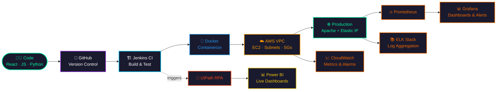

<!-- ═══════════════  HEADER  ═══════════════ -->
<div align="center">


<a href="https://github.com/psgaikwad2003">
  
</a>

<br/>


<br/><br/>

<a href="https://www.linkedin.com/in/YOUR-REAL-LINKEDIN-SLUG"></a>
<a href="mailto:psgaikwad2003@gmail.com"></a>
<a href="https://wa.me/919359850496"></a>
<a href="https://github.com/psgaikwad2003?tab=repositories"></a>


</div>

<!-- ═══════════════  ABOUT  ═══════════════ -->


## 👋 About Me

I'm a **Computer Engineering graduate** who likes the full journey of software: writing the app, containerizing it, deploying it on AWS, and watching it with proper monitoring. My motto: **ship reliable systems, automate everything, never touch it twice.**

```yaml
now:
  building   : "CI/CD pipelines + containerized deployments on AWS"
  learning   : ["Kubernetes", "Terraform (IaC)", "GitHub Actions", "System Design"]
  exploring  : "Observability with Prometheus, Grafana & ELK"
  looking_for: "DevOps / Cloud / Full-Stack roles (fresher / entry-level)"
  ask_me_about: ["AWS VPC networking", "Docker", "Jenkins", "React", "RPA with UiPath"]
fun_fact: "I automate things I'd otherwise do twice."
```

<!-- ═══════════════  SNAKE  ═══════════════ -->

<div align="center">

<picture>
  <source media="(prefers-color-scheme: dark)" srcset="https://raw.githubusercontent.com/psgaikwad2003/psgaikwad2003/output/github-snake-dark.svg"/>
  <source media="(prefers-color-scheme: light)" srcset="https://raw.githubusercontent.com/psgaikwad2003/psgaikwad2003/output/github-snake.svg"/>
  
</picture>

<sub>🐍 Generated by GitHub Actions. See <code>.github/workflows/profile.yml</code></sub>

</div>

<!-- ═══════════════  TECH STACK  ═══════════════ -->


## 🧰 Tech Stack

<div align="center">

| Domain | Tools |
|:--|:--|
| ☁️ **Cloud & DevOps** |       |
| 📡 **Observability** |      |
| 💻 **Languages** |     |
| 🌐 **Frontend** |    |
| 🗄️ **Data & Automation** |    |
| 🛠️ **Tools** |    |
| 🎯 **Currently learning** |    |

</div>

<!-- ═══════════════  PIPELINE  ═══════════════ -->

## 🚀 How My Code Ships



<!-- ═══════════════  PROJECTS  ═══════════════ -->


## 🏗️ Featured Projects

<table>
<tr>
<td width="50%" valign="top">

### ☁️ AWS VPC Web Server Deployment
`EC2` `VPC` `IAM` `NAT Gateway` `Apache`

- Designed a **custom VPC** with public/private subnets, route tables and NAT
- Hardened EC2 using **Security Groups, NACLs, IAM** and an Elastic IP
- Applied **AWS Well-Architected** security and reliability practices

[📂 View repo](https://github.com/psgaikwad2003/REPO-NAME) · [📖 Write-up](#)

</td>
<td width="50%" valign="top">

### 🧾 Invoice Extraction Automation
`UiPath` `Power BI` `RPA` `CI-triggered`

- End-to-end RPA pipeline extracting **vendor, amount, date, tax**
- **Live Power BI dashboards** for real-time financial visibility
- Eliminated manual data entry (**zero-touch** processing)

[📂 View repo](https://github.com/psgaikwad2003/REPO-NAME) · [🎥 Demo](#)

</td>
</tr>
<tr>
<td width="50%" valign="top">

### 📦 Stock Management System
`HTML` `CSS` `JavaScript` `MySQL` `RBAC`

- **Automated low-stock alerts** so nothing runs out unnoticed
- **Role-based access control** for admins and staff
- Optimized SQL queries for large datasets

[📂 View repo](https://github.com/psgaikwad2003/REPO-NAME)

</td>
<td width="50%" valign="top">

### 🛒 E-Commerce Platform
`HTML` `CSS` `JavaScript`

- Dynamic **product filtering** and search
- **Real-time cart** updates without page reloads
- Fully **responsive** across mobile, tablet and desktop

[📂 View repo](https://github.com/psgaikwad2003/REPO-NAME) · [🌐 Live demo](#)

</td>
</tr>
</table>

### 📌 Pinned Repositories

<div align="center">

<a href="https://github.com/psgaikwad2003/REPO-1"></a>
<a href="https://github.com/psgaikwad2003/REPO-2"></a>

</div>

<!-- ═══════════════  EXPERIENCE  ═══════════════ -->

## 💼 Experience

```text
┌─ Web Development Intern ── Exaltasoft Solutions, Pune ── Dec 2024 → Feb 2025
│   ├─ Built responsive React.js components from design specs
│   ├─ Integrated REST APIs to power dynamic front-end features
│   └─ Ran cross-browser testing and fixed rendering defects before deploy
│
└─ Python Programming Intern ───────────────────────────── Feb 2024 → Mar 2024
    └─ Automated backend data-handling workflows with Python scripts
```

## 🎓 Education & Certifications

<div align="center">


</div>

<!-- ═══════════════  STATS  ═══════════════ -->


## 📊 GitHub Analytics

<div align="center">


<br/>


<br/>


</div>

<details>
<summary><b>🧊 3D contribution view (click to expand)</b></summary>
<br/>
<div align="center">
  
</div>
</details>

<!-- ═══════════════  FOOTER  ═══════════════ -->


<div align="center">

### 🤝 Let's build something reliable together

📧 **psgaikwad2003@gmail.com** &nbsp;│&nbsp; 📱 **+91 93598 50496** &nbsp;│&nbsp; 📍 **Pune, Maharashtra**


</div>
