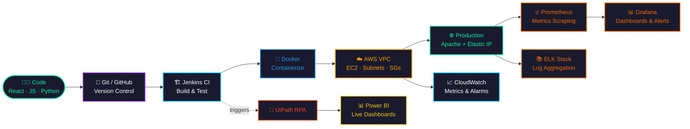

<div align="center">


<h1 align="center">⚡ PRAJWAL GAIKWAD ⚡</h1>
<h3 align="center">🖥️ FULL-STACK DEV &nbsp;|&nbsp; ☁️ CLOUD &amp; DEVOPS &nbsp;|&nbsp; 🤖 AUTOMATION 🖥️</h3>


<br/>


<br/><br/>

<a href="https://www.linkedin.com/in/Prajwal_Gaikwad">
  
</a>
<a href="https://github.com/psgaikwad2003/">
  
</a>
<a href="mailto:psgaikwad2003@gmail.com">
  
</a>
<a href="tel:+919359850496">
  
</a>


</div>

<br/>


##  `whoami`

```yaml
$ cat profile.yaml
──────────────────────────────────────────────
name        : Prajwal Gaikwad
role        : Full-Stack Developer · Cloud &amp; DevOps Engineer
location    : Pune, Maharashtra, IN
education   : B.E. Computer Engineering | CGPA 8.83/10
              Pravara Rural Engineering College, Loni
mission     : Ship reliable systems. Automate everything. Never touch it twice.
stack_focus : AWS · Docker · CI/CD · React · REST APIs · RPA
observability : CloudWatch · Prometheus · Grafana · ELK Stack
──────────────────────────────────────────────
```

<br/>

##  `deployment pipeline` — how code ships



<br/>


##  `tech stack`

<div align="center">

<br/>

**⚙️ Cloud &amp; DevOps**
<br/>


**📡 Observability &amp; Monitoring**
<br/>
&nbsp;&nbsp;

**💻 Languages &amp; Frameworks**
<br/>


**🗄️ Database, Tools &amp; Automation**
<br/>
&nbsp;&nbsp;&nbsp;

</div>

<br/>

##  `infrastructure built`

<table width="100%">
<tr>
<td width="50%" valign="top">

### ☁️ AWS VPC Web Server Deployment
`EC2` `VPC` `IAM` `Security Groups` `NAT Gateway`

```diff
+ Custom VPC: public/private subnets, route tables, NAT
+ Hardened EC2 (Apache) — Security Groups, NACLs, Elastic IP
+ AWS Well-Architected Framework practices applied
```

</td>
<td width="50%" valign="top">

### 🧾 Invoice Extraction Automation
`UiPath` `Power BI` `RPA` `CI-triggered`

```diff
+ End-to-end RPA pipeline: vendor, amount, date, tax
+ Live Power BI dashboards for real-time financial data
+ Zero manual data entry
```

</td>
</tr>
<tr>
<td width="50%" valign="top">

### 📦 Stock Management System
`HTML` `CSS` `JS` `MySQL` `RBAC`

```diff
+ Automated low-stock alerts
+ Role-based access control
+ Query optimization for large datasets
```

</td>
<td width="50%" valign="top">

### 🛒 E-Commerce Platform
`HTML` `CSS` `JavaScript`

```diff
+ Dynamic product filtering
+ Real-time cart updates
+ Fully responsive UI
```

</td>
</tr>
</table>

<br/>


##  `experience.log`

```bash
[2024-12-01 → 2025-02-28] Web Development Intern @ Exaltasoft Solutions, Pune
  ├─ Built responsive React.js components from design specs
  ├─ Integrated REST APIs for dynamic front-end features
  └─ Cross-browser testing → resolved rendering defects pre-deploy

[2024-02-01 → 2024-03-31] Python Programming Intern
  └─ Automated backend data-handling workflows via Python scripts
```

<br/>

##  `system metrics`

<div align="center">


</div>

<br/>

##  `certifications`

<div align="center">


</div>

<br/>


<div align="center">

### 📡 `connect --to=prajwal`

📧 **psgaikwad2003@gmail.com** &nbsp;│&nbsp; 📱 **+91 9359850496** &nbsp;│&nbsp; 📍 **Pune, Maharashtra, India**

<br/>


</div>
